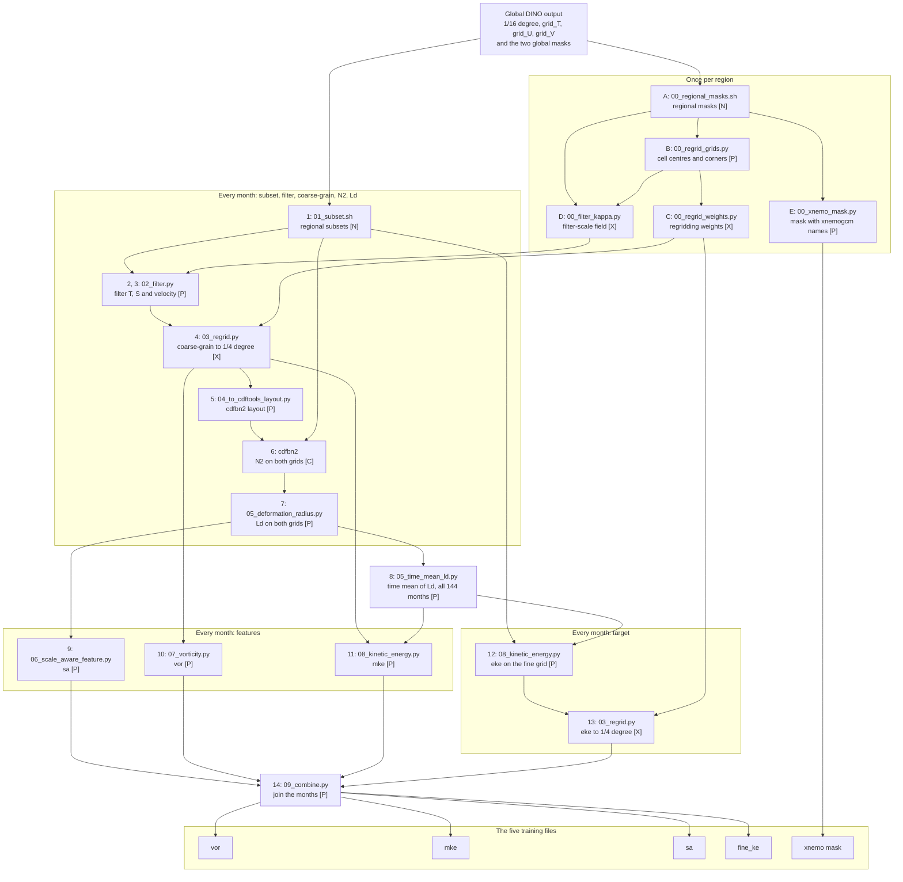

# Data pipeline

The scripts that made the training data of the models in this repository, from the
DINO model output to the five files per region that the models read. They are
published so that a reader can see how those files were made, and repeat it.

The training files are on Zenodo, for the four regions `SO_JET`, `SO_EAST`, `SO_GYRE`
and `SO_TROP`. **The files on Zenodo are the reference.** They were not made again for
the release, and the pipeline is not needed to use the models.

## What it makes

Five files per region, each with 4320 daily fields (144 months of 30 days, model years
0061 to 0072), except the mask:

| File | Variable | What it holds |
|---|---|---|
| `MINT_1d_0061-0072_vor_cg_{region}_mod.nc` | `vor` | relative vorticity of the coarse-grained velocity |
| `MINT_1d_0061-0072_mke_{region}.nc` | `coarse_ke` | kinetic energy of the filtered coarse-grained velocity |
| `MINT_1d_0061-0072_sa_cg_{region}.nc` | `sa` | deformation radius over the grid scale |
| `MINT_1d_0061-0072_eke_Lmin3LdO25_cg_{region}.nc` | `fine_ke` | the target: eddy kinetic energy below the filter scale |
| `mesh_mask_exp4_{region}_xnemo.nc` | mask, grid | the 1/4 degree mesh mask with xnemogcm dimension names |

## The chain

The 1/16 degree model output is cut to a region, filtered and coarse-grained to the 1/4
degree grid. The features (`sa`, `vor`, `mke`) come from the coarse fields. The target
(eddy kinetic energy) is made on the fine grid first and then coarse-grained. The
letters and numbers are the "rows" used in the scripts and in the reference. The tag in
each box is the software that runs it: **P** the `pyCDFTOOLS` environment, **X** the
`regrid_xesmf_cond` environment, **N** `ncks`, **C** `cdfbn2`.



Not every arrow is drawn: several steps also read the regional masks of row A and the grids
of row B. Rows 1 to 7 must have run for all 144 months before row 8, and row 8 before rows
11 and 12, which read the time means.

## The scripts

All are in this directory. `F` is `paths.features` of the config, `R` the region, `m` one
month, `MINT_1d_<first day>_<last day>`.

| Script | Row | What it does | Reads | Writes | Env |
|---|---|---|---|---|---|
| `00_regional_masks.sh` | A | cuts the regional masks from the two global masks | the global masks | `F/R/mesh_mask_exp{16,4}_R.nc`, and `_surface_` (first level) versions | N |
| `00_regrid_grids.py` | B | cell centres and corners of both grids; stops if the box does not give the index ranges of the config | the global masks | `F/R/R_input_grid_16.npy`, `R_target_grid_025.npy` | P |
| `00_regrid_weights.py` | C | conservative weights, 1/16 to 1/4 degree | B | `F/R/weights_R.nc` | X |
| `00_filter_kappa.py` | D | kappa, which sets the filter scale of rows 2 and 3 | A, B | `paths.kappa/kappa16_R.nc` | X |
| `00_xnemo_mask.py` | E | the 1/4 degree mask with xnemogcm dimension names | A | `F/R/coarsened_data/mesh_mask_exp4_R_xnemo.nc` (a training file) | P |
| `01_subset.sh` | 1 | cuts the region from the global output | `m_grid_{T,U,V}.nc` | `paths.subsets/R/m_grid_{T,U,V}_R.nc` | N |
| `02_filter.py` | 2, 3 | filters T and S (`grid_T`) or the surface velocity (`grid_UV`) on the fine grid | 1, A, D | `F/R/filtered_data/m_{thetao,so,uo,vo}_f_R.nc` | P |
| `03_regrid.py` | 4, 13 | coarse-grains a filtered field, or the fine-grid `eke`, to 1/4 degree | 2, 3 or 12, A, B, C | `F/R/coarsened_data/m_<variable>_cg_R.nc` | X |
| `04_to_cdftools_layout.py` | 5 | puts coarse T and S in the layout `cdfbn2` reads | 4, 1 | `..._{thetao,so}_cg_R_cdftools.nc` | P |
| `cdfbn2` (CDFTOOLS) | 6 | N2 on the 1/4 grid, and on the 1/16 grid from the subset | 5, 1 | `..._bn2_cg_R.nc`, `F/R/m_bn2_R.nc` | C |
| `05_deformation_radius.py` | 7 | deformation radius Ld from N2, `--mode cg` or `non_cg` | 6, A | `..._Ld_cg_R.nc`, `F/R/m_Ld_R.nc` | P |
| `05_time_mean_ld.py` | 8 | time mean of Ld over the whole period | 7, all months | `MINT_1d_00610101_00721230_Ld_{cg_,}R.nc` | P |
| `06_scale_aware_feature.py` | 9 | `sa`, Ld over the grid scale | 7, A | `..._sa_cg_R.nc` | P |
| `07_vorticity.py` | 10 | relative vorticity of the coarse velocity | 4, A | `..._vor_cg_R.nc` | P |
| `08_kinetic_energy.py` | 11, 12 | `--variable mke` (coarse velocity filtered at 3Ld) or `eke` (fine velocity, below the filter scale) | 4 or 1, 8, A | `..._mke_R.nc`, `F/R/m_eke_Lmin3LdO25_R.nc` | P |
| `09_combine.py` | 14 | joins the months into a training file | 9, 10, 11 or 13 | `F/R/coarsened_data/MINT_1d_<y0>-<y1>_*.nc` | P |
| `config.example.yml` | | every path, and the lat/lon box and index ranges of each region | | | |
| `slurm_example.sh` | | one step (row 12) as a SLURM job, with placeholders | | | |

## Using it

Copy `config.example.yml`, set the paths, and pass the copy as `--config`. Every script
takes `--region` and `--config`; every script except the five `00_*` also takes `--start`
and `--end`. Run each in its environment (a full `conda activate` of the environment;
xesmf does not import otherwise), from a directory you can write to: some scripts write a
`.log` file there.

```bash
# once per region: the regional masks [N], the regridding grids [P], the weights [X]
bash 00_regional_masks.sh --region SO_JET --config config.yml
python 00_regrid_grids.py --region SO_JET --config config.yml
python 00_regrid_weights.py --region SO_JET --config config.yml

# one month: filter temperature [P], then coarse-grain it [X]
python 02_filter.py --region SO_JET --start 00610101 --end 00610201 --config config.yml --variable grid_T --variable-name thetao
python 03_regrid.py --region SO_JET --start 00610101 --end 00610201 --config config.yml --variable thetao

# the scale-aware feature [P]
python 06_scale_aware_feature.py --region SO_JET --start 00610101 --end 00610201 --config config.yml

# join the months into a training file [P]
python 09_combine.py --region SO_JET --start 00610101 --end 00610201 --config config.yml --variable sa_cg
```

- The model has a 360-day calendar: every month runs from day 01 to day 30, so `--start`
  and `--end` must both be day 01 of a month. `--end` is exclusive.
- `--start 00610101 --end 00730101` is all 144 months; `--start 00610101 --end 00610201` is
  January 0061 alone.

These short commands were checked against the `--help` of each script. They were not run
as a chain. The full sequence in the reference, with `cdfbn2` and the time means, was run
end to end for `SO_JET`, January 0061.

## What you need

Not on Zenodo, so not here either:

- the global DINO model output at 1/16 degree, 432 monthly files (`grid_T`, `grid_U`,
  `grid_V` for 144 months), about 5.9 TB;
- the two global mesh masks, `mesh_mask_exp16.nc` (1/16 degree) and `mesh_mask_025.nc`
  (1/4 degree).

Software, recorded in `envs/`:

- `envs/pyCDFTOOLS.yml`: environment P (xarray, xgcm, xnemogcm, gcm_filters).
- `envs/regrid_xesmf_cond.yml`: environment X (xesmf with ESMF).
- `ncks` from NCO, with a `python3` that has PyYAML, and `cdfbn2` from CDFTOOLS, with
  its namelists in `cdftools/`: see `envs/other_tools.md`.


## More detail

[docs/REFERENCE.md](docs/REFERENCE.md) has the region table, the directory layout, the
full command sequence for one region (with the `ncks` and `cdfbn2` commands written out),
what each step reads and writes, every option, the oddities that are kept on purpose
because they are how the released files were made, the things to know when running it,
and how the scripts were checked against the files on Zenodo.
